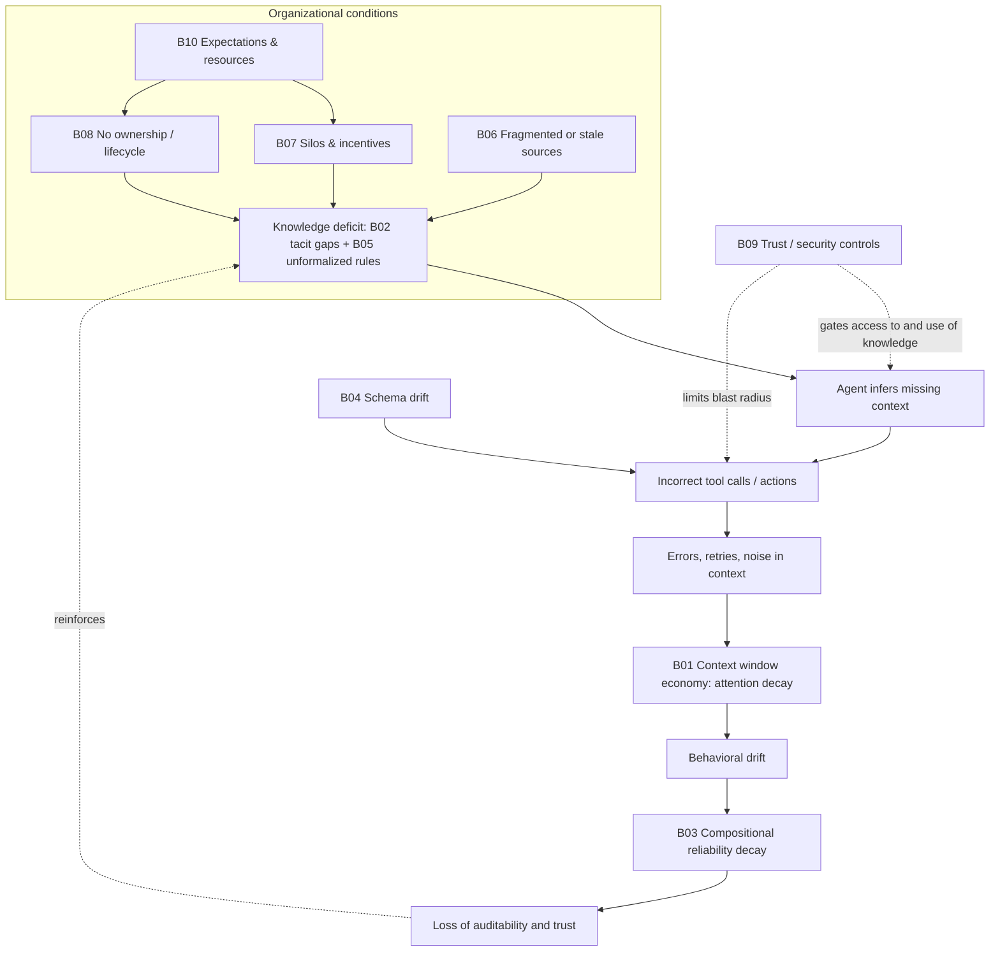

## 🛡️ LEGAL NOTICE
>By continuing to access or use this document, you acknowledge that you have read, understood, and agree to be bound by the 11Protocol [Licensing & Intellectual Property terms](https://github.com/11protocol/publications/tree/main?tab=License-1-ov-file).
# Evidence-Based Diagnostic and Mitigation Framework for Knowledge Readiness in Agentic AI

*Citation markers [n] are numbered in order of first appearance and resolve to the References section. Source verification notes and the rationale for evidence ratings are in Appendix B.*

## How to Read This Report

**Evidence legend.** Evidence statements use the five-tier scale defined in the research mandate. The tiers describe the evidence actually found, not an automatic rating of importance:

| Tier | Meaning |
| :---- | :---- |
| **1 — Strong empirical support** | Replicated or convergent empirical findings, ideally with direct outcome evaluation |
| **2 — Moderate empirical support** | Credible studies with limitations in replication, generalizability, or design |
| **3 — Established theoretical or methodological foundation** | Defensible concepts or methods with limited direct evidence for the agentic-AI application |
| **4 — Promising but preliminary** | Early studies, simulations, case reports, expert proposals |
| **5 — Speculative hypothesis** | Plausible mechanisms or analogies without sufficient direct evidence |

**Source quality.** Most agentic-AI-specific sources available in 2025–2026 are preprints, practitioner articles, or vendor material. Each reference in the reference list carries a type label. Where a claim rests only on vendor or unreviewed sources, the text says so. *Evidence that a problem exists is reported separately from evidence that an intervention solves it.*

**What is original synthesis.** The consolidation of barriers into root causes, amplifiers, and cross-cutting controls (Deliverable B), the autonomy-based relevance guidance, and the differential-diagnosis step (Deliverable F) are the report's own expert-judgment synthesis. They are labeled as such and are not presented as empirical findings.

---

## Deliverable A: Executive Synthesis

The transition from conventional software and deterministic AI to agentic AI represents a significant shift in organizational computing. Agentic systems — defined by their capacity to reason, plan, use tools, maintain state, and execute multi-step workflows — demand a far more rigorous integration of enterprise knowledge than their passive generative predecessors [1]. Organizations encounter recurring difficulties when supplying these systems with the knowledge they need. A central pattern is an *institutional impedance mismatch*: the conflation of digital data availability with operational knowledge readiness [2]. Exposing an agent to enterprise data lakes or uncurated document repositories is not sufficient for reliable task execution.

Cybernetic theory offers a useful lens, with an important caveat: it is a design principle, not an empirical finding about organizations. Ashby's Law of Requisite Variety and the Good Regulator Theorem hold that a system that regulates an environment must contain a sufficiently accurate model of that environment [3, 4, 5]. Applied here, an agent lacking a high-fidelity representation of organizational practices, tacit constraints, and business rules is poorly placed to act safely within that organization [6]. This report uses the term *knowledge debt* as a working construct for the accumulated divergence between operational reality and the explicit context available to computational systems [7, 8]; the cited sources use the term loosely, and it should be treated as a framing device rather than a validated measure. The divergence shows up as behavioral drift, compositional reliability decay over long task horizons, and loops of guessing, failing, and retrying that consume token budgets [1].

The distinction between conventional retrieval-augmented generation (RAG) and agentic systems is one of *consequence and compounding*: missing context in a conventional system typically produces a poor text response, while missing context in an agentic system can produce incorrect, unguided execution of enterprise tools.

**What the evidence most supports**

1. **Context is a scarce, positional resource.** Long-context models use information unevenly, with reduced reliability for material in the interior of long inputs [2, 9]. Delivering *curated* context matters more than delivering *more* context.
2. **Failures compound with autonomy.** Multi-step agents degrade multiplicatively when individual steps are unreliable and unverified [1, 10].
3. **Tacit and procedural knowledge is the hardest layer to supply.** Theory is mature [11]; LLM-assisted elicitation is promising but, so far, demonstrated mainly in simulation [12, 13].
4. **Rules that carry compliance or financial consequence need deterministic enforcement** outside the model's probabilistic reasoning [14, 15]. This is a well-established design principle in decision management; direct evidence for agent-plus-rules-engine architectures is still early.
5. **Many barriers are organizational, not architectural.** Silos, absent ownership, undocumented practice, fragmented or stale data, weak incentives, and unrealistic expectations determine whether the knowledge exists, is trustworthy, and is current — before any architecture can deliver it. The evidence for these in the *agentic* setting is largely practitioner-level (see Deliverable C).
6. **Security and accountability are part of knowledge readiness.** What an agent may know, trust, and remember is a governance question as well as a retrieval question [16, 17, 18].

**Not every failure is a knowledge failure.** Model limitations, defective reasoning, software defects, integration faults, inadequate permissions, and poor task design can all produce symptoms that look like missing context. Deliverable F therefore begins with a differential-diagnosis step before any barrier is assigned.

**Architecture is a means, not the answer.** Mitigations such as the Model Context Protocol (MCP) [19, 20], Practice Graphs [21], Business Rule Management Systems (BRMS) [15], and specification-driven development [10] are strong candidates for specific barriers, but each has trade-offs, and several have limited independent evaluation. Process, governance, and incentive interventions may be more appropriate than technology for a given barrier; the barrier-to-intervention matrix (Deliverable E) maps each explicitly.

**How to use the report.** Deliverable B lists ten consolidated barriers and classifies which warrant default screening. Deliverable F supplies the diagnostic logic. Deliverable E and G connect each diagnosed barrier to interventions and playbooks. Deliverable H identifies where the evidence is weakest and how to validate the framework in the field.

---
## Deliverable B: Consolidated Barrier Taxonomy

The research taxonomy proposed thirteen discovery dimensions (A–M). Rather than reproduce them as a checklist, this section consolidates overlapping dimensions into **ten barriers** with stable identifiers, separates root causes from amplifying dynamics, and classifies each by screening priority. Interdisciplinary evidence shows that the barriers extend well beyond standard data-quality issues: they are structural, cognitive, organizational, and architectural.

### B.1 Barrier overview

| ID | Barrier | Role in the causal model *(expert-judgment synthesis)* | Applies to | Screening class | Overall evidence status |
| :---- | :---- | :---- | :---- | :---- | :---- |
| **B01** | Context Window Economy & Institutional Impedance Mismatch | Amplifier | RAG and agentic; worsens with autonomy | Feature-triggered | Tier 1 (positional degradation); Tier 4 (agentic retry-loop dynamics) |
| **B02** | Tacit Knowledge Attrition & Epistemological Friction | Root cause | All | Default | Tier 3 (theory); Tier 4 (LLM elicitation) |
| **B03** | Compositional Reliability Decay & Behavioral Drift | Amplifier / failure dynamic | Multi-step agents | Feature-triggered | Tier 3 (mathematical); Tier 4 (agentic magnitude) |
| **B04** | Architectural Schema Drift & Tool Fragility | Root cause (infrastructural) | Tool-using agents | Feature-triggered | Tier 3; MCP-specific evidence Tier 4 |
| **B05** | Business Rule Ambiguity & Governance Gaps | Root cause | All rule-bound or consequential use cases | Default | Tier 3; agent-plus-BRMS Tier 4 |
| **B06** | Fragmented, Low-Quality, or Stale Source Knowledge | Root cause | All | Default | Tier 3 (data management) |
| **B07** | Silos, Incentives & Knowledge Culture | Root cause (organizational) | All | Program-level | Tier 3; direct agentic evidence limited |
| **B08** | Missing Ownership, Skills & Knowledge Lifecycle | Root cause (organizational) | All | Default | Tier 3; direct agentic evidence limited |
| **B09** | Trust, Provenance, Security & Compliance Gaps | Cross-cutting control | All; critical where agents act or touch sensitive data | Default (basic) / deeper when regulated | Tier 3 (standards); control effectiveness varies |
| **B10** | Misaligned Expectations & Resource Constraints | Root cause (strategic) | All | Program-level | Tier 4–5 (practitioner judgment) |

**Screening classes.** *Default* barriers should be screened for every use case. *Feature-triggered* barriers should be screened when the system has the relevant feature (long or multi-turn context, multi-step execution, tool use against changing systems). *Program-level* barriers are enabling conditions best assessed once per organization or program rather than per use case. This classification is expert judgment based on the causal structure in Deliverable D; no prevalence data supports it, and none is claimed.

### B.2 Barrier definitions

#### B01 — The Context Window Economy and Institutional Impedance Mismatch

The Context Window Economy is the regime in which knowledge delivery to an agent is bounded by token budgets, attention decay, and latency costs [2]. Organizations frequently assume that supplying an agent with large repositories of enterprise data amounts to providing context. In practice, every token allocated to one piece of knowledge is unavailable for another [2]. Large language models also show positional biases — the "lost in the middle" effect — in which information in the interior of long contexts is used less reliably than information at the boundaries [2, 9].

This produces an institutional impedance mismatch. When agents lack carefully structured operational context, they can fall into a cycle of guess, failure, correction, and retry [2]. Each failed tool call and error message adds material to the context window, which can degrade effective reasoning and increase latency cost [2]. The underlying barrier is less a lack of data than an inability to compress, curate, and allocate institutional knowledge as a scarce resource. It affects agentic workflows more than passive generative tools because an agent's iterative reasoning consumes its own context over time.

#### B02 — Tacit Knowledge Attrition and Epistemological Friction

A substantial share of critical operational knowledge is tacit — embedded in human expertise, informal networks, and uncodified professional judgment rather than documentation [22]. Nonaka's SECI model (Socialization, Externalization, Combination, Internalization) describes how tacit knowledge becomes explicit [11]; applying it to AI consumption creates *epistemological friction* [23]. Traditional elicitation forces experts to map nuanced judgments into rigid predefined taxonomies, which can lose edge cases and contextual rationale [12]. Not all expertise can be formalized without loss, so elicitation methods should aim to preserve exceptions, rationale, and uncertainty rather than flatten them.

As experts leave or change roles, access to this knowledge is lost. One simulation study modeled organizational knowledge dissemination as a Susceptible–Infectious (SI) process with *waning infectivity*, in which a person's ability to share a fact decays over time [13]. **This is a modeling assumption used to generate synthetic organizations for testing an elicitation agent, not empirical evidence that real tacit knowledge decays by those dynamics**; the study itself leaves validation with real employees to future work [13]. Without capturing the tacit layer — exceptions, historical precedent, nuanced trade-offs — agents may understand *what* to do but not *how* the organization prefers it done.

#### B03 — Compositional Reliability Decay and Behavioral Drift

Agentic systems operate through autonomous reasoning-and-acting loops [1]. Unlike traditional software, whose execution paths are explicitly specified, agentic behavior emerges stochastically from the interaction of prompts, memory, tools, and environment [1]. The resulting barrier is *compositional reliability decay*: if a task requires a series of steps and each succeeds with probability *p*, end-to-end success under an independence assumption falls as *p* raised to the number of steps [1]. This is arithmetic, not an empirical estimate; real failure dependence between steps can make outcomes better or worse.

Compounding this is *behavioral drift*, in which an agent's interpretation of its instructions shifts as episodic memory accumulates errors or irrelevant artifacts across a session [1]. Organizations without verification harnesses and specification-driven development practices report difficulty completing complex multi-step tasks reliably [10]. This barrier separates single-turn applications from agents that must persist state and maintain coherence across many sequential operations.

#### B04 — Architectural Schema Drift and Tool Fragility

Agents rely on tools to act on the environment, yet the interfaces, APIs, and data schemas of enterprise systems evolve constantly. Schema drift can sever an agent's ability to act [24]. When backend systems change, agents relying on rigid, hardcoded tool descriptions may lose the ability to interact safely.

The problem is exacerbated when organizations fail to separate the stochastic reasoning model from the deterministic execution environment [6]. Without standardized tool discovery, versioning, and change signaling, agents can issue malformed calls against deprecated schemas [19], which may corrupt data, stall workflows, or expose protected data. This barrier is primarily infrastructural: it is the failure to give the agent a stable boundary interface to its environment.

#### B05 — Business Rule Ambiguity and Governance Gaps

This barrier is the organizational failure to separate deterministic business requirements from probabilistic AI reasoning. Organizations often embed specific compliance-driven rules directly in an agent's system prompt or context [10]. This produces gaps in traceability, auditability, and consistent enforcement [10]. As rule sets grow, maintaining many overlapping rules in prose becomes impractical and invites inconsistent or invented exceptions. A probabilistic agent is a poor substitute for a deterministic decision system and is better governed by one [14]. Governing an agent through prompt text alone means safety controls can be bypassed or lost during long reasoning chains.

#### B06 — Fragmented, Low-Quality, or Stale Source Knowledge

*(Practitioner-level evidence.)* Knowledge is spread across CRM, ERP, intranets, documents, spreadsheets, and email with no common model; formats and definitions differ; content is duplicated, conflicting, or out of date. An agent cannot assemble coherent context from sources that disagree or that no one has validated. Practitioners commonly report that integration effort dominates AI projects, but no controlled evidence for this was verified in the present review. Related sub-issues from the mandate include missing provenance, missing temporal validity, absent negative knowledge ("what we tried and rejected"), and missing decision history.

#### B07 — Silos, Incentives & Knowledge Culture

Knowledge hoarding, fragmented accountability, competing departmental objectives, resistance to documentation, fear of automation, and the absence of incentives for sharing leave institutional knowledge in silos or informal "tribal" memory. Authority, trust, and informal networks shape what knowledge is disclosed, validated, and used. This barrier is a precondition for B02 and B08: elicitation and curation fail without participation. It is assessed at program level because it tends to be shared across use cases.

#### B08 — Missing Ownership, Skills & Knowledge Lifecycle

Few organizations have defined roles for curating AI-facing knowledge (knowledge engineering, taxonomy and ontology stewardship, rule stewardship), or defined processes for versioning, review cadence, freshness, and feedback. Without ownership and lifecycle processes, even good initial knowledge becomes stale, and corrections from users or reviewers never reach the knowledge base. This includes the absence of a structured path for lessons from human supervision to become approved organizational knowledge, as distinct from conversational history or one-off corrections.

#### B09 — Trust, Provenance, Security & Compliance Gaps

Agents need to know what they may access, what they should believe, and when to defer. Gaps include missing provenance and source attribution, weak access control at the retrieval layer, no audit trail of what was retrieved and acted on, undefined instruction precedence, and exposure to prompt injection and knowledge or memory poisoning. Principal risk categories for LLM applications, including prompt injection and data or model poisoning, are catalogued by OWASP [17]; risk-management structure is provided by the NIST AI Risk Management Framework [16]; and the EU AI Act imposes logging, transparency, and human-oversight obligations on high-risk systems [18]. Over-redaction for privacy can also strip context an agent needs, creating a trade-off between B09 and B01/B06.

#### B10 — Misaligned Expectations & Resource Constraints

*(Evidence is practitioner judgment.)* Leaders may believe models will "just know" what to do, skip the work of preparing knowledge, or expect autonomy the knowledge foundation cannot support. Knowledge capture, curation, evaluation, and maintenance carry recurring cost against competing priorities and short-term ROI pressure. This barrier is assessed at program level and shapes which interventions are feasible: phased adoption, minimum viable knowledge foundations, and risk-based prioritization are the usual responses.

### B.3 Relevance by level of agent autonomy *(expert-judgment guide)*

| Level | Description | Barriers that gain weight |
| :---- | :---- | :---- |
| **L0** | Conversational assistant or RAG over documents; human reads output | B06, B08, B09 (provenance), B02 |
| **L1** | AI-assisted workflow; human performs actions | + B05, B01 |
| **L2** | Tool-using agent; human approves each consequential action | + B04, B03 |
| **L3** | Agent acts autonomously within defined bounds | + B05 and B09 become critical; B03 and B04 decisive |
| **L4** | Persistent, multi-agent, memory-writing systems | + B08 (memory governance), B09 (poisoning), B03 |

The scale is a working device for this framework, not an established standard. Consequence of error and reversibility should adjust the weighting at any level.

---

## Deliverable C: Evidence and Research Matrix

The matrix connects each consolidated barrier to its supporting literature, delineates the strength of the evidence, and records boundary conditions and open questions. Ratings use the tiers defined at the start of this report; the rationale for the ratings is summarized in Appendix B.

| Barrier | Key causal mechanisms | Primary literature & fields | Evidence status & confidence | Gaps, contradictions & boundary conditions |
| :---- | :---- | :---- | :---- | :---- |
| **B01 Context Window Economy** | Token-budget constraints; attention decay ("lost in the middle"); latency cost escalation; guess-fail-retry loops [2] | Computer science, AI engineering; benchmark evaluations of LLM long-context behavior [2, 9] | **Tier 1** for positional degradation in long contexts (primary study [9], consistent with [2]). **Tier 4** for the agentic retry-loop and token-economy dynamics, which rest on preprint-level sources [2] | Optimal balance between episodic memory retention and compression is model-dependent [25]. Positional effects vary by model and may shrink as models improve; re-test on the models actually deployed |
| **B02 Tacit Knowledge** | SECI externalization friction; loss of edge cases in forced taxonomies; expert turnover; boundary-object gaps [12, 21, 23] | Organizational behavior, knowledge management, cognitive science; SECI [11]; sociotechnical studies [23]; LLM-elicitation review [12] | **Tier 3** for the theory. **Tier 4** for LLM-based elicitation: demonstrated in simulation with synthetic organizations and simulated employees [13]; literature review [12]. The SI/waning-infectivity model is a simulation assumption, **Tier 5** as a description of real organizations [13] | No validation with real employees yet [13]. Quantifying tacit loss in hierarchical versus flat networks is unresolved [13]. Risk that elicitation flattens judgment into false rules |
| **B03 Compositional Decay & Drift** | Multiplicative error propagation; stochastic execution paths; absent verification gates; no specification-driven development [1, 10] | Software and reliability engineering; comparative studies of traditional versus agentic software engineering [1, 10] | **Tier 3** for the mathematics (valid under independence). **Tier 4** for measured magnitude in agentic workflows: sources are preprints [1, 10] | Whether reflection or self-correction can outpace multiplicative decay on long tasks is open. Step dependence can make the independence model pessimistic or optimistic |
| **B04 Schema Drift & Tool Fragility** | API evolution; absent dynamic discovery and change signaling; monolithic agent design without an integration abstraction [19] | Systems architecture, interoperability standards; MCP specification [20]; MCP analyses [19, 24] | **Tier 3** for abstraction layers and interface versioning. **Tier 4** for MCP gateways specifically: open specification [20] plus vendor and practitioner guidance [24]; protocols are newly deployed | Latency and cost of gateways at scale are under-researched [19]. Gateway behavior varies by product; verify against the deployed implementation |
| **B05 Rule Ambiguity & Governance Gaps** | Conflating probabilistic inference with deterministic logic; lack of auditability; reliance on prompts for constraints [10, 14] | Governance, risk management, decision management [14, 15]; agent harness and governance practice [6] | **Tier 3** (long-standing decision-management practice). **Tier 4** for agent-plus-BRMS architectures: practitioner and vendor sources [14, 15]. *No cited source supports a measured failure-rate comparison between LLM-inferred logic and a BRMS, so none is claimed.* | Balancing deterministic strictness with the adaptability expected of agents without creating rigidity. Rules cannot capture judgment that was never formalized (see B02) |
| **B06 Fragmented / Stale Source Knowledge** | Silos, inconsistent schemas, conflicting sources, missing provenance and temporal validity | Data management, metadata and lineage practice, knowledge management | **Tier 3.** Practitioner reports of integration burden; no controlled agentic evidence verified | Effect sizes of data-foundation work on agent reliability are unquantified; risk of over-engineering ahead of proven use cases |
| **B07 Silos, Incentives & Culture** | Hoarding, misaligned incentives, fear of automation, weak sponsorship | Organizational behavior, knowledge sharing and organizational learning [11] | **Tier 3.** Established in KM theory; direct agentic-AI evidence limited | Which incentive designs work for AI-context contribution specifically is untested |
| **B08 Ownership, Skills & Lifecycle** | No curator roles; no review cadence or versioning; no feedback path from supervision to approved knowledge | Knowledge management, software configuration management, MLOps practice | **Tier 3.** Established process practice; direct agentic evidence limited | How best to promote feedback into shared knowledge without treating every correction as authoritative is an open design question |
| **B09 Trust, Provenance, Security & Compliance** | Absent attribution and audit trail; excessive agent privileges; injection and poisoning; regulatory traceability duties | Standards and risk management [16, 17, 18]; security engineering | **Tier 3** (authoritative standards). Control effectiveness is context-dependent | Standards state requirements and risk categories rather than demonstrating intervention outcomes; empirical evaluation of controls is thin |
| **B10 Expectations & Resources** | Overestimated model inference; underfunded knowledge work; short-horizon ROI | Management science; practitioner analyses | **Tier 4–5.** Practitioner judgment | Rigorous studies linking expectation management to outcomes were not identified |

**Reading the matrix.** Across the strongest-supported barriers, failures of agentic systems are rarely attributable only to the foundation model. They are more often rooted in the sociotechnical architecture around it. The literature from systems engineering, epistemology, and reliability engineering converges on the design principle that contextual delivery should be structurally decoupled from the agent's generative core — but this convergence is largely at the level of *design principle*, and direct controlled comparisons remain scarce.

---
## Deliverable D: Barrier Interaction and Causal Model

The barriers do not operate in isolation; they are interdependent components of a sociotechnical system. Understanding their interaction draws on systems dynamics and cybernetics, particularly Ashby's Law of Requisite Variety and the Good Regulator Theorem [3, 5]. The causal structure below is an **expert-judgment synthesis** that assembles evidence from the sources cited per barrier; it is a hypothesis for field testing, not an empirically validated model.

### D.1 Cybernetic framing

The Good Regulator Theorem holds that, for a regulator (here, the agentic AI) to control a system, it must contain a model of that system [3, 5]; see also [26]. The Ethical Regulator Theorem extends this: effective and ethical regulation requires clear goals, requisite predictability, and awareness feedback [4]. When organizations fail to capture tacit knowledge (B02) or to codify business rules deterministically (B05), they deprive the agent of an accurate organizational model. Lacking it, the agent cannot reliably anticipate the consequences of its actions in the specific enterprise [4], and maps a generalized worldview onto an idiosyncratic workflow. *Scientific analogies are treated here as design hypotheses; the report does not claim the theorems "prove" the failures described.*

### D.2 Upstream organizational causes

Before any agent runs, organizational conditions determine what knowledge is available to supply. Silos and weak incentives (B07) suppress documentation and sharing; absent ownership and lifecycle processes (B08) let knowledge go stale; fragmented sources (B06) prevent coherent assembly; and misaligned expectations and thin resourcing (B10) keep these conditions unaddressed. Together they feed the **knowledge deficit** that B02 and B05 describe. Weak trust and security controls (B09) cut across all of them: they decide whether knowledge that *does* exist can be used safely.

### D.3 The reinforcing loop of operational degradation

The initial deficit triggers a reinforcing loop. When an agent lacks precise situational context, it must infer missing parameters. This inference can lead to hallucinated values or incorrect tool calls. In a minimally governed environment, the agent executes these actions against enterprise APIs. If the APIs have undergone schema drift (B04), the call fails because the agent holds deprecated contextual understanding, and the backend returns an error.

At this point the Context Window Economy (B01) becomes the systemic bottleneck. The agent attempts to correct its mistake by analyzing the error, entering a guess-fail-retry loop [2]. The original prompt, the failed tool call, the error trace, and the agent's own reasoning all consume token budget. As the window fills with this operational noise, attention decay sets in [2], the agent can lose sight of the original objective, and behavioral drift accelerates.

Over a multi-step sequence, this appears as Compositional Reliability Decay (B03) [1]: a process that should have taken three reliable steps takes fifteen error-prone ones, and the cumulative probability of failure rises. Because business rules were not governed externally (B05), supervisors cannot easily audit *why* the agent chose a given path. This can end in loss of trust, abandonment of the automated workflow [10], and further accumulation of what this report calls knowledge debt: the widening gap between the speed at which AI operates and the organization's ability to maintain cognitive governance over its actions [8].



### D.4 High-leverage intervention points *(expert judgment)*

- **A structural harness around the agent.** Hard architectural boundaries — a gateway for tool validation (B04) and a deterministic rules engine for consequential decisions (B05) — reduce what the agent must infer, which in cybernetic terms constrains the system's variety and narrows the model the agent needs [6, 15, 19]. This tends to compress the required context, limit retry loops, and replace probabilistic guessing with explicit retrieval of documented knowledge. This is the leverage point proposed by the architectural sources; its measured effect is still to be established (see Deliverable H).
- **Ownership and lifecycle (B08).** One intervention here touches B02, B05, B06, and B09 because it determines whether knowledge gets created, validated, and kept current.
- **Verification gates and human escalation.** Intermediate verification interrupts compounding error (B03) and routes unresolved tacit-knowledge cases to people (B02), producing the feedback that closes the loop.
- **Evaluation harness (cross-cutting).** Without measurement, interventions cannot be attributed; this is also the means to separate knowledge failures from model or workflow failures (Deliverable F, Step 0).

### D.5 Competing explanations

A causal model for *knowledge* barriers must not absorb all failures. Competing explanations include model limitations or defective reasoning, software defects, integration failures, inadequate permissions, and poor task design. These can mimic knowledge deficits, and they can also coexist with them. Deliverable F's differential-diagnosis step is intended to rule them in or out.

---

## Deliverable E: Barrier-to-Intervention Matrix

The table defines the most defensible interventions for each diagnosed barrier, mapping architectural, operational, and organizational responses. Relations are many-to-many: one barrier may need several interventions, and one intervention may address several barriers. Evidence and maturity statements describe what was found; "vendor" and "practitioner" indicate where the support is not independent research.

### E.1 Matrix

| Target barrier(s) | Intervention | Mechanism | Evidence & maturity | Trade-offs & limitations | Validation |
| :---- | :---- | :---- | :---- | :---- | :---- |
| **B04** Schema drift & tool fragility | **MCP enterprise gateway** | Decouples the agent from raw APIs. A gateway sits between agent and backend, can enforce identity-aware access, and filters tool parameters before they reach the agent's context [19, 24] | Open protocol specification [20]; gateway guidance mostly vendor/practitioner [24, 27]. **Emerging.** Tier 4 | Adds latency and centralized infrastructure (hub-and-spoke or federated mesh); requires disciplined API lifecycle management [19]. Does not govern *what* the agent decides | Staging schema-change test; tool-call failure rate; malformed-call rate; permission-boundary tests |
| **B05** Rule ambiguity & governance gaps | **Deterministic Business Rule Management System (BRMS) boundary** | Moves business logic out of prompts. The agent proposes or gathers; the rules engine decides and returns an approve / deny / escalate signal [14, 15] | Long-standing decision-management practice (Tier 3); agent-plus-BRMS evidence from practitioner and vendor sources [14, 15]. **Established method, emerging pairing.** Latency figures such as "sub-100 ms" are vendor-reported [15] | Raises initial complexity; needs analysts to own the rule repository separately from AI engineering [14]. Governs only formalizable rules; effective only if the orchestration harness prevents bypass | Edge-case regression suite targeting compliance violations; decision-trace completeness; rule-change cycle time |
| **B02** Tacit knowledge | **Tool-oriented SECI co-creation and agentic elicitation** | LLM agents interview experts in a prompt-chained setting, structuring tacit know-how into explicit forms such as Practice Graphs [12, 13, 21] | Strong theory [11]; elicitation by LLM agents shown in **simulation** with synthetic organizations [13] and surveyed in a literature review [12]. **Experimental** | Employee resistance if framed as automating them away; requires human-in-the-loop validation of generated practices [23]; risk of flattening judgment | Expert review of elicited practices; before/after performance on held-out edge cases; escalation-rate reduction |
| **B01**, B02 | **Meta Context Engineering and Practice Graphs** | Replaces flat retrieval with dynamic context orchestration; Practice Graphs deliver situated know-how (tools, rules, memory) when the workflow needs it [21, 25] | Preprint-level [21, 25]. **Experimental/emerging.** Tier 4 | Needs substantial ontological mapping; not achievable by naive vector-database RAG alone [21]; knowledge graphs and hybrid retrieval carry build and maintenance cost | Retrieval evaluation (context precision/recall); context-token efficiency; task success on representative workflows |
| **B03** Compositional decay | **Specification-driven development (SDD) and verification gates** | Shifts the primary human-agent artifact from final output to formal specification; the agent executes against a contract, enabling discrete verification of sub-tasks [10] | Preprint-level [10]; verification and contract-based design are established engineering practice (Tier 3). **Emerging for agents** | Slows rapid "vibe coding"; demands rigor in specifying requirements up front [10] | Success rate by task length; defects caught at each gate; rework rate |
| **B02**, B03, B05 | **Human-in-the-loop escalation and structured feedback** | Defines stop conditions (conflicting signals, high consequence); the agent pauses and packages context for a human; decisions and rationale are logged and fed into approved knowledge | Practitioner sources; established human-factors and safety-engineering practice (Tier 3). **Established principle, immature agent-specific evidence** | Too many handoffs defeat the value of autonomy; thresholds must be tuned; reviewers need the right interface and authority | Escalation rate and resolution time; reviewer close-call surveys; recurrence of previously corrected errors |
| **B06** Fragmented / stale sources | **Scoped data foundation: inventory, unified entities, metadata, provenance and lineage** | Gives agents a consistent, tagged, attributable source of truth for the *needed* domain | Established data-management practice (Tier 3); practitioner reports on integration burden | Costly and slow if over-built; begin with the sources a prioritized use case needs rather than enterprise-wide consolidation | Coverage of needed sources; freshness; data-error rate caught in testing |
| **B07**, B10 | **Sponsorship, incentives, communities of practice, knowledge audit** | Makes knowledge sharing and documentation valued and findable; locates where critical knowledge lives | Established organizational-change practice (Tier 3); effect on AI-context quality untested | Slow; can become bureaucratic; incentive design must avoid rewarding volume over quality | Contribution rates and quality; participation in elicitation; time-to-update |
| **B08** Ownership & lifecycle | **Named owners, review cadence, versioning, curator roles; controlled consolidation of memory** | Assigns accountability for each knowledge asset; separates conversational history, persistent memory, approved knowledge, and executable rules; treats user corrections as proposals until reviewed | Established configuration-management practice (Tier 3); agent-memory governance **emerging**; see taxonomy of agent memory [28] | Governance overhead; avoid heavy committees (lightweight cadence preferred) | Staleness (age of assets versus review cadence); proportion of corrections reviewed; error recurrence |
| **B09** Trust, security, compliance | **Source attribution, immutable audit logging, retrieval-layer access control, threat modeling, write-gating for memory** | Makes answers traceable; limits what the agent can see and change; reduces exposure to injection and poisoning | Authoritative standards and risk catalogues [16, 17, 18]. **Established as requirements**; control effectiveness varies | Adds latency and engineering effort; over-redaction can remove needed context | Traceability tests; red-team and injection tests; access-boundary tests; audit completeness |
| **B10** Expectations & resources | **Phased adoption, minimum viable knowledge foundation, risk-based prioritization** | Sequences work by consequence and feasibility; shows value early; budgets recurring maintenance | Practitioner judgment (Tier 4–5) | Quick wins can be mistaken for general readiness; risk of under-investing in foundations | Milestones met; cost per validated knowledge asset; incident rate on expanded scope |

### E.2 Prevent, detect, or contain

Distinguishing what an intervention does matters for choosing starting points.

| Intervention | Prevents | Detects | Contains |
| :---- | :---- | :---- | :---- |
| MCP gateway | Calls against unapproved or stale schemas (if implemented as designed) | Malformed or unauthorized calls (logging) | Privilege exposure |
| BRMS boundary | Non-compliant decisions on rule-covered cases | Rule-violating proposals | Consequence of agent error |
| Agentic elicitation / Practice Graphs | Loss of known tacit practice | — | — |
| SDD / verification gates | Propagation of early errors | Step-level failures | Compounding error |
| Human escalation | — | Novel, conflicting, high-consequence cases | Consequence of agent error |
| Data foundation / lifecycle | Stale or conflicting context | Freshness lapses | — |
| Audit, attribution, access control | Unauthorized access | Incidents (forensics) | Blast radius |
| Evaluation harness (Deliverable F, H) | — | Regressions and recurring errors | — |

### E.3 Choosing a starting point *(expert judgment)*

- **Agent takes consequential, rule-bound actions:** begin with the BRMS boundary and human escalation (B05), together with access control and audit (B09), before expanding autonomy.
- **Agent calls internal systems that change often:** begin with a gateway or equivalent abstraction and staging tests (B04).
- **Agent performs well on short tasks but fails on long ones:** begin with specification and verification gates (B03), then examine context curation (B01).
- **Agent lacks "how we do it here":** begin with scoped elicitation and expert review (B02) for one workflow, supported by ownership (B08).
- **Resources are scarce:** choose one high-value, low-consequence workflow; build a minimum viable knowledge foundation (B06, B08, B10); instrument it; and expand.

Where an intervention is organizational rather than technical (B07, B08, B10), a technical solution should not be substituted for it.

### E.4 Analysis of core mitigation strategies

#### 1. Model Context Protocol (MCP) enterprise gateways

MCP is an open standard that allows AI agents to discover and call external tools through a common client–server interface, standardizing how context is shared [20, 27]. In an enterprise deployment, an MCP gateway sits between the agent and the internal network. When an agent requests a tool (for example, a patient-record lookup), the gateway can intercept the request, authenticate the agent using OAuth 2.0 or OpenID Connect, and filter the tool schema according to identity-aware access controls [24].

If a user delegating a task is not authorized to see certain financial or health data, the gateway can remove those parameters from the schema before the agent is exposed to them [24]. This reduces the chance that the agent attempts unauthorized calls and reduces token load on the model [24]. Rather than relying on static, version-bound contracts that break when APIs evolve, MCP supports dynamic tool discovery (the specification includes mechanisms for listing tools and for servers to notify clients when the tool list changes [20]); the analysis in [19] describes this as schemas evolving through iterative negotiation that preserves the agent's understanding of tool capabilities. *Note: how much "negotiation" occurs depends on the specific gateway and server implementation, so it should be verified in staging rather than assumed.* Guidance on gateway design is largely vendor-authored [24, 27].

#### 2. Deterministic Business Rule Management Systems (BRMS)

Governing an autonomous agent purely through natural-language prompts is unreliable for compliance-critical logic: prompts are interpreted probabilistically, whereas many compliance and operational requirements are deterministic. Integrating an agent with a BRMS lets the agent serve as an orchestration and reasoning component while the BRMS handles decision logic [15].

For example, in automated loan origination or healthcare prior authorization, the agent collects unstructured context from the user, structures it, and submits it to the BRMS [15]. The BRMS — maintained through no-code interfaces by business subject-matter experts — executes the logic and returns an approve, deny, or escalate signal [14]. This creates a hard boundary around rule-covered decisions, supports auditable traceability, and allows rules to be updated without retraining or re-prompting the model [15]. Vendor and practitioner sources report that such separation curbs errors and shortens turnaround as rules change [15]; **independent evaluation is not yet available**. The boundary holds only if the agent cannot route around it, which is an orchestration-design responsibility, and it covers only logic that has been formalized.

#### 3. Practice Graphs and boundary objects

Traditional RAG relies on knowledge graphs that map entities (who, what, where). Agentic AI needs knowledge of organizational know-how (how and why); Practice Graphs are proposed to map this [21]. A Practice Graph is a socio-cognitive architecture built on a minimal affordance ontology [21]. Nodes are typed by their agent engagement mode, representing tools, policies, precedent cases, and procedural memory.

By acting as *boundary objects* — a concept from science and technology studies describing artifacts that serve multiple communities while keeping a recognizable identity [29] — these nodes can inhabit several communities at once (domain experts, developers, AI agents) while maintaining coherence without requiring full consensus on semantic meaning [21]. When an agent encounters a task, it retrieves the relevant sub-graph, which supplies a bounded, contextualized account of how the organization handles that process and reduces reliance on generic pre-training data [21]. The Practice Graph proposal shifts emphasis from context engineering toward what the source calls "practice engineering" [21]. This work is at the preprint stage; no independent field evaluation was identified.

#### 4. Specification-driven development (SDD)

To address compositional reliability decay, SDD shifts the primary artifact of development away from final output and toward rigorous specifications [10]. Humans define architectural constraints, behavioral expectations, and verification steps in a formalized contract, and the agent executes against it. Because multi-agent teams require a shared substrate to avoid conflicting outputs, the specification serves as a single source of truth [10]. It limits compounding error by allowing discrete steps to be verified against a fixed standard before dependent tasks proceed [10].

#### 5. Human-in-the-loop escalation and feedback capture

Where tacit knowledge or conflicting rules prevent the agent from deciding safely, the design should treat human judgment as a first-class control. Catalogue decisions where tacit knowledge is likely (exceptions processing, policy overrides); define stop conditions; make the agent pause and package context for a person; log the human decision and rationale; and route reviewed outcomes into approved knowledge. Escalation should shrink over time only if the lessons are validated, not simply because users correct the agent. Treating every user correction as authoritative is itself a risk (B09).

#### 6. Governance, lifecycle, and security controls

Assign ownership to each knowledge asset, define review cadence and versioning, and separate conversational history, persistent memory, approved knowledge, and executable rules. Require attribution and audit logging, enforce access control at the retrieval layer, and model threats including prompt injection and knowledge poisoning [16, 17].

### E.5 Illustrative healthcare examples (vendor-reported; not validation)

Vendor material describes healthcare deployments of agents with HIPAA-aligned access controls and EHR integration [30]. A contact-center vendor reports that one U.S. health system lowered call abandonment by 69% after deploying AI agents integrated with its EHR [31]. These are vendor-reported outcomes from contact-center deployments. They do not isolate the contribution of the interventions in this report (gateways, rules engines, practice graphs), and they should not be read as evidence that those interventions work.

An academic comparison of multi-agent and single-agent designs on the eICU database reported modestly higher mortality-prediction accuracy for the multi-agent design (59% versus 56%) and lower mean length-of-stay error (4.37 versus 5.82 days), while transparency scores were essentially equal, with the single-agent design slightly higher (86.21 versus 85.5) [32]. This is a model-architecture comparison within one dataset, not an evaluation of knowledge-supply interventions.

---
## Deliverable F: Diagnostic Questionnaire and Assessment Logic

To move from theory to practice, organizations need a tool to assess exposure to the identified barriers. The assessment uses **triangulation** — comparing stakeholder statements against documents, workflow observation, system telemetry, and measured outcomes — because self-reported confidence does not establish actual capability. Questions are written to detect *conditions*, not familiarity with AI terminology. The questionnaire and logic below are a **first-pass design that has not yet been field-validated** (see Deliverable H).

### F.0 Step 0 — Differential diagnosis: is this a knowledge problem?

Run these checks on a sample of failing cases *before* attributing failures to a barrier. They are standard ablation-style tests proposed here as a protocol; they have not been validated as a formal method.

| Competing explanation | Quick test | Interpretation |
| :---- | :---- | :---- |
| **Context is missing or wrong (knowledge failure)** | Re-run failing cases with hand-curated, verified context (an "oracle context") | If failures disappear, a knowledge/context barrier is likely; proceed to Stage 1 |
| **Model limitation or defective reasoning** | Re-run with the oracle context and a stronger model, or isolate the reasoning step with no tools | If failures persist even with perfect context, suspect model capability or reasoning design |
| **Software defect** | Replay deterministically with fixed inputs and tool outputs; unit-test tool wrappers and parsers | Reproducible failure independent of model behavior points to code |
| **Integration or permission failure** | Call the tools directly with the agent's credentials; inspect authorization errors, timeouts, and malformed payloads | Errors at the tool boundary point to B04 or access configuration, not missing knowledge |
| **Poor task design** | Ask whether a competent new employee could complete the task from the same written instructions and materials | If not, the task or specification is under-specified; fix design before supplying more knowledge |

Failures commonly have more than one cause; Step 0 is meant to apportion them, not to find a single culprit.

### F.1 Stage 1 — Initial screening and symptom identification

For each screen, answer the question, inspect the evidence, and record the barrier indicated. Screens S1–S5 come from the technical-symptom analysis; S6–S10 extend the instrument to organizational and governance conditions.

**S1 — High latency, surging token costs, and "lost" agents** *(B01)*
- *Diagnostic question:* Do your agentic workflows show highly variable execution times, often requiring multiple internal retries or sequential corrections before producing a result? Do agents seem to forget instructions given earlier in the session?
- *Evidence to inspect:* Telemetry on the ratio of prompt tokens to generated tokens; execution logs for guess-fail-retry loops; frequency of context-window exhaustion [2].
- *Barrier indicated:* The Context Window Economy. The agent lacks structured upfront context, suffers attention decay, and is working against its token limit [2].

**S2 — Brittle tool execution and silent failures** *(B04)*
- *Diagnostic question:* When backend IT systems update their APIs or data schemas, do your agents fail unpredictably, stall, or act against incorrect endpoints without warning?
- *Evidence to inspect:* Hardcoded API definitions inside agent prompts; absence of a centralized gateway or schema-validation layer; frequency of malformed JSON errors in tool-execution logs [19].
- *Barrier indicated:* Architectural schema drift and tool fragility [19].

**S3 — Policy violations and unexplainable decisions** *(B05)*
- *Diagnostic question:* Are compliance requirements, business rules, and access constraints defined purely in natural language within the system prompt? Can business stakeholders update rules without developer intervention?
- *Evidence to inspect:* Prompt length (long prompts loaded with negative "do not" instructions); absence of a standalone decision engine or explicit escalation boundaries [10].
- *Barrier indicated:* Governance gaps and rule ambiguity [14].

**S4 — Severe performance drop-off in complex workflows** *(B03)*
- *Diagnostic question:* Does the agent perform reliably on single-step retrieval tasks but fail badly on multi-turn workflows requiring sequential reasoning and state management?
- *Evidence to inspect:* Benchmark or test data showing success falling sharply as task length increases; absence of intermediate verification gates [1].
- *Barrier indicated:* Compositional reliability decay [1].

**S5 — Loss of context during exception handling** *(B02)*
- *Diagnostic question:* Is the agent unable to handle edge cases that human operators resolve through unwritten departmental consensus? Does it lack the rationale behind historical decisions?
- *Evidence to inspect:* Absence of recorded decision rationale in knowledge bases; reliance on siloed human oversight for basic exceptions; staff resistance to documenting tacit practice [22].
- *Barrier indicated:* Tacit knowledge attrition and epistemological friction [23].

**S6 — Stale, conflicting, or unattributable sources** *(B06, B08, B09)*
- *Diagnostic question:* When two sources disagree, or a source is old, can anyone say which the agent should trust, and can the agent show which it actually used?
- *Evidence to inspect:* Sample 20 recent agent outputs; trace each key claim to a source with a named owner and date; count claims that are untraceable, stale, or contradicted by another source.

**S7 — Knowledge lives in a few people and sharing is not rewarded** *(B07, B02)*
- *Diagnostic question:* If your three most experienced people in this process left next quarter, what could not be reconstructed from anything written down? Is documentation part of anyone's goals or recognition?
- *Evidence to inspect:* Interviews with practitioners in different teams about where they actually get answers; contribution and edit history of knowledge repositories; whether documentation appears in role expectations; the formal procedure versus observed workflow.

**S8 — No owner, no cadence, corrections that go nowhere** *(B08)*
- *Diagnostic question:* For the knowledge this agent relies on, can you name an owner for each major asset and the date it was last reviewed? When a user corrects the agent, where does the correction end up?
- *Evidence to inspect:* A register of knowledge assets with owners and review dates; follow the last 10 user corrections to their destination (nowhere, a prompt, a document, a rule); whether recurring errors reappear after being corrected.

**S9 — Permissions, memory writes, and untrusted content** *(B09)*
- *Diagnostic question:* Do agent privileges exceed those of the person who delegated the task? Can retrieved or user-supplied text change the agent's instructions or memory? Is every retrieval and action logged?
- *Evidence to inspect:* Privilege inventory versus delegating-user permissions; a controlled test that places an instruction inside a retrieved document; audit-log completeness; whether memory writes require review [16, 17].

**S10 — Expectations and funding** *(B10)*
- *Diagnostic question:* Do stated success criteria match the knowledge foundation that exists today? Is there a recurring budget line and an accountable owner for knowledge maintenance, or only for the initial build?
- *Evidence to inspect:* Project charter and success metrics; budget documents; scope changes since the pilot; comparison of executive and operational descriptions of what the agent can do.

### F.2 Maturity indicators and specialist-assessment triggers

| Barrier | Absent | Partial | Effective practice | Seek specialist assessment when |
| :---- | :---- | :---- | :---- | :---- |
| **B01** | No context budgeting; whole documents dumped in | Some retrieval filtering; retries not tracked | Curated context per task; measured retrieval quality; retry loops monitored | Costs or quality degrade at scale with no clear cause |
| **B02** | Practice exists only in people's heads | Ad hoc interviews; documents with no rationale | Structured elicitation reviewed by experts; rationale and exceptions recorded; tested on edge cases | Decisions carry legal, safety, or clinical consequence |
| **B03** | No verification between steps | Some checks on final output | Specifications and gates between dependent steps; success tracked by task length | Long-horizon, high-consequence autonomy |
| **B04** | Hardcoded endpoints and schemas in prompts | Some abstraction; changes discovered after failure | Gateway or abstraction layer; staging tests for schema change; change signaling | Many integrated legacy or regulated systems |
| **B05** | Rules only in prompts | Some rules in code, undocumented | Formalized, versioned rules owned by business; harness enforces boundary; regression suite | Regulated decisions (credit, health, employment) |
| **B06** | Siloed, inconsistent sources | Partial integration; unknown freshness | Scoped source-of-truth with metadata, provenance, freshness tracking | Heavy legacy estate or M&A data |
| **B07** | Hoarding; no incentives | Sponsorship without incentives | Visible sponsorship, incentives, communities of practice, measured participation | Persistent resistance despite sponsorship |
| **B08** | No owners or cadence | Owners named, cadence irregular | Owners, review cadence, versioning; corrections reviewed and promoted | Memory-writing or multi-agent systems |
| **B09** | No attribution, broad privileges | Logging without review; some access control | Attribution, immutable audit, retrieval-layer access control, tested for injection | Regulated or high-risk classification applies [18] |
| **B10** | Expectations unexamined; no maintenance budget | Pilot-focused funding | Risk-based roadmap with recurring budget and accountable owner | Program spans many business units |

**Dependencies.** B07, B08, and B10 are enabling conditions for B02 and B05. B06 and B08 underlie B01 (curation needs trustworthy sources). B09 gates the safe use of everything else. Remediate in dependency order where possible, running enabling conditions in parallel with technical fixes.

### F.3 Stage 2 — Deeper assessment

For every screen answered "yes" or "unsure," run the corresponding evidence inspection against a **representative sample of real tasks including edge cases**, with a second reviewer, and attach a confidence note. Compare at least two independent evidence types (for example, stakeholder interview versus log analysis) before declaring a barrier present; where they disagree, treat the barrier as *possible* and record what evidence would resolve it. Users who cannot yet establish the root cause can still record "possible issue" and proceed to the matrix with several candidate interventions.

### F.4 Assessment logic and prioritization

**Method.** For each flagged barrier, rate qualitatively (High / Medium / Low): *impact* (consequence of error multiplied by the agent's autonomy and the reversibility of its actions), *likelihood* (strength of the observed symptoms), *evidence confidence* (the tier from Deliverable C), *urgency*, and *remediation feasibility*. Rank by impact first, then by feasibility and dependency order. Do not convert these into numeric scores; the available evidence does not support that precision.

**Default ordering when agents take consequential actions** *(expert judgment; the tiers below are not empirically derived and should be adjusted by risk):*

> 1. **Critical priority (immediate remediation before scaling):** If the screens show S2 (schema drift) or S3 (rule ambiguity) where the agent acts on systems holding sensitive or regulated data, the organization is exposed to security, privacy, and compliance risk because the agent has autonomy without deterministic boundaries. **Intervention strategy:** introduce rule decoupling (BRMS or equivalent) and a tool-governance layer (such as an MCP gateway) before scaling agentic workloads to production [15, 19].
> 2. **High priority (fix to ensure operational viability):** If S1 (token cost and retry loops) or S4 (compositional decay) is present, the system is likely to be economically unviable and unreliable over long horizons. **Intervention strategy:** implement specification-driven development and move from flat document retrieval toward structured context engineering [10].
> 3. **Moderate priority (fix to achieve organizational depth):** If S5 (tacit attrition) is the primary constraint, the system may operate safely but remain organizationally shallow, unable to replicate expert judgment. **Intervention strategy:** deploy LLM-assisted elicitation workflows with expert validation to construct Practice Graphs based on the tool-oriented SECI model [21].
> 4. **Enabling conditions (in parallel):** S6–S10 findings determine whether the above can be sustained. Where S9 shows excessive privileges or injectable memory, treat as critical regardless of other findings.

**Quick screen versus deep assessment.** The ten screens form a first-pass instrument that can be completed in a workshop. Deep assessment (F.3) is warranted for barriers flagged high-impact or where the evidence types disagree.

---

## Deliverable G: Implementation Playbooks

The playbooks translate the findings into phased procedures. Each states target barriers, prerequisites, responsible roles, steps, and measurable outcomes. They are procedural guidance synthesized from the cited sources and standard practice; the sequencing is expert judgment and has not been field-tested as a package.

### G.0 Choosing playbooks by circumstance

| Circumstance | Start with |
| :---- | :---- |
| Regulated or consequential decisions | Playbook 2 (rules boundary), Playbook 4 (escalation), Playbook 5 (audit and governance) |
| Frequent system change, many integrations | Playbook 1 (gateway), Playbook 6 (scoped data) |
| Expertise concentrated in a few people | Playbook 3 (elicitation), Playbook 5 (ownership) |
| Constrained budget or small organization | Playbook 6 scoped to one use case, Playbook 4 and Playbook 5 in lightweight form |

### Playbook 1: Establishing an MCP Gateway for Agentic Interoperability

**Target barrier:** B04 Schema drift and tool fragility. **Prerequisites:** an internal API catalog; a defined enterprise identity provider (for example, OAuth 2.0 or OpenID Connect). **Responsible roles:** Enterprise Architect, DevSecOps Engineer, AI Systems Integrator.

**Implementation steps:**

> 1. **Decouple tools from prompts:** Audit all agent instructions. Remove hardcoded API URLs, rigid JSON schemas, and access credentials from system prompts.
> 2. **Deploy the gateway architecture:** Position an enterprise MCP gateway between agents and internal backend services. Choose a centralized hub-and-spoke model for tight control or a federated mesh for geographically distributed architectures [24].
> 3. **Establish schema allowlisting:** Configure the gateway to enforce strict input and output validation with strongly typed schemas (for example, Pydantic models). It should filter unexpected parameters or invented variables before the schema reaches the agent's context [24].
> 4. **Implement identity-aware access:** Bind the gateway to the organizational identity provider. Make authorization evaluate the permissions of the *human user delegating the task*, not the baseline privileges of the agent. This limits privilege escalation and the blast radius of prompt injection [24]; it does not by itself prevent injection, so pair it with the controls in Playbook 5 [17].
> 5. **Continuous validation:** Simulate a schema change in a staging backend. Confirm that the agent receives the updated tool definition and either adapts correctly or fails safely, without manual prompt edits [19, 20]. Verify actual behavior against the specific gateway product rather than assuming negotiation features.

**Measurable outcomes:** tool-call failure and malformed-call rates; time to recover from a schema change; permission-boundary test pass rate; proportion of prompts free of hardcoded endpoints.
**Trade-offs:** latency overhead; centralized infrastructure to operate; requires API lifecycle discipline [19].

### Playbook 2: Decoupling Logic with a Deterministic BRMS Boundary

**Target barrier:** B05 Governance gaps and rule ambiguity. **Prerequisites:** documented business requirements; an existing agent orchestration framework. **Responsible roles:** Business Analyst (subject-matter expert), AI Systems Engineer, Compliance Officer.

**Implementation steps:**

> 1. **Extract and formalize rules:** Audit the agent's system prompts and memory. Extract explicit business constraints, compliance checks, and routing logic (for example, "if the transaction exceeds $10,000, require secondary human review") [14].
> 2. **Codify in a BRMS:** Use a no-code BRMS to build a deterministic decision matrix. Have business analysts rather than software developers own and maintain it so that rules can change quickly [15].
> 3. **Establish the handoff protocol:** Re-engineer the workflow so that the agent gathers unstructured input, synthesizes it into a standard payload, and calls the BRMS.
> 4. **Enforce the execution boundary:** Constrain the agent through the orchestration harness so it waits for the BRMS response and executes *only* the authorized path. The agent must not use probabilistic reasoning to override the BRMS decision [15].
> 5. **Continuous validation:** Run a regression suite of edge cases designed to trigger compliance violations. Confirm the BRMS intercepts and denies prohibited actions and leaves an immutable audit trail of decision rationale [15]. Latency targets such as "sub-100 ms" are vendor-reported; measure in your own environment.

**Measurable outcomes:** share of rule-covered decisions passing through the BRMS; regression-suite pass rate; rule-change cycle time; completeness of the decision audit trail.
**Limitations:** covers only formalized rules; judgment-heavy cases should route to Playbook 4.

### Playbook 3: Tacit Knowledge Elicitation and Practice Graph Construction

**Target barriers:** B02 Tacit knowledge attrition (supports B01). **Prerequisites:** knowledge-graph infrastructure (for example, a graph database such as Neo4j); identified domain experts; an internal chat deployment; expert time protected by management (B07, B10). **Responsible roles:** Knowledge Engineer, Operations Manager, Human-Computer Interaction Specialist.

**Implementation steps:**

> 1. **Deploy elicitation agents:** Using prompt-chaining, deploy an LLM-based agent in a partially observable environment (for example, a Slack or Teams integration) to act as a conversational interviewer [12, 13].
> 2. **Run the SECI loop:** Let the agent engage domain experts (Socialization), ask clarifying questions about undocumented processes, and structure responses into documented workflows (Externalization) [23].
> 3. **Validate with the experts:** Have experts review and correct the structured output before it is stored. The automated elicitation results to date come from simulation, so real-world validation is essential [13, 23].
> 4. **Construct the Practice Graph:** Instead of tagging documents by topic, build a graph ontology typed by agent affordances, mapping elicited knowledge into boundary objects for *Tools*, *Policies*, *Precedents*, and *Constraints* [21]. Record rationale and exceptions, not only conclusions.
> 5. **Operationalize:** Embed practice nodes in the agent's retrieval architecture so that for a complex task the agent retrieves the specific operational know-how required [21]. Capture the knowledge before anticipated expert departures.
> 6. **Continuous validation:** Compare agent performance on operational edge cases before and after integration; measure reductions in human escalation and gains in operational efficiency [21].

**Measurable outcomes:** share of sampled edge cases handled correctly; expert acceptance rate of elicited practices; escalation-rate trend; recurrence of previously corrected errors.
**Trade-offs:** employee resistance if perceived as automating roles away [23]; the approach is at an experimental stage.

### Playbook 4: Human Escalation and Structured Feedback

**Target barriers:** B02, B03, B05 (supports B08). **Prerequisites:** a catalogue of decision types and their consequence; reviewers with authority and time. **Responsible roles:** Process Owner, Risk/Compliance Lead, Domain Reviewers, AI Engineer.

**Implementation steps:**

> 1. **Identify high-risk decisions:** List tasks where tacit knowledge or rule conflict is likely (exceptions, overrides). Specify stop conditions (conflicting signals, high consequence, low confidence).
> 2. **Encode what can be encoded:** Move common exceptions into explicit rules (Playbook 2) or documented knowledge, and record which cases must always route to a human.
> 3. **Design escalation paths:** When a stop condition triggers, the agent pauses and hands the reviewer the relevant inputs, retrieved sources, and policies in one view. Log the decision and its rationale.
> 4. **Close the loop with review:** Treat reviewer outcomes and user corrections as *proposals*. Route validated ones into approved knowledge or rules through the lifecycle process in Playbook 5; do not let a single correction rewrite shared behavior.
> 5. **Tune thresholds:** Start conservative on novel or high-stakes cases and relax only as measured performance justifies it.

**Measurable outcomes:** escalation volume and resolution time; reviewer "close call" reports; recurrence of corrected errors; share of escalation outcomes promoted into approved knowledge.
**Trade-offs:** excessive handoffs negate the benefit of autonomy; thresholds require ongoing calibration.

### Playbook 5: Ownership, Lifecycle, and Governance (Knowledge Culture)

**Target barriers:** B07, B08, B09, B10. **Prerequisites:** executive sponsor; agreement on the first use case. **Responsible roles:** Executive Sponsor, Knowledge Owners, Security and Legal, Steering group (lightweight).

**Implementation steps:**

> 1. **Secure sponsorship and framing:** Align the knowledge effort to named business outcomes and set realistic expectations about what the agent can and cannot do (B10).
> 2. **Run a knowledge audit:** Identify where critical knowledge lives, who holds it, and which sources conflict; use the S6–S8 evidence inspections.
> 3. **Assign ownership and cadence:** Name an owner for each asset, set a review cadence, and version policies, procedures, and rules. Define separate stores for conversational history, persistent memory, approved knowledge, and executable rules.
> 4. **Set content standards:** Provide templates and metadata (owner, date, scope, permissions, provenance) so content is usable by AI.
> 5. **Embed security and traceability:** Require source attribution, immutable audit logs, retrieval-layer access control, and write-gating for memory; threat-model for prompt injection and poisoning; map obligations under applicable regulation [16, 17, 18].
> 6. **Create incentives:** Recognize contributors, establish communities of practice, and include knowledge contribution in expectations where appropriate.
> 7. **Review and adapt:** Use a lightweight recurring review (for example, short regular check-ins rather than a large committee) to track metrics and adjust policy.

**Measurable outcomes:** share of assets with owner and current review date; time from validated correction to updated knowledge; audit-log completeness; participation in knowledge contribution.
**Trade-offs:** governance can become bureaucratic if over-built; prefer lightweight, enabling structures.

### Playbook 6: A Scoped Data Foundation

**Target barriers:** B06 (supports B01, B08). **Prerequisites:** a prioritized use case; an inventory of candidate sources. **Responsible roles:** Data Architect, Data Steward, Domain Lead.

**Implementation steps:**

> 1. **Audit and prioritize:** Inventory repositories (CRM, ERP, documents, spreadsheets); score them for relevance to the chosen use case and for quality.
> 2. **Define a minimal shared model:** With business units, agree common entities and definitions needed *for this use case* (an ontology or taxonomy where useful).
> 3. **Build pipelines for the needed sources:** Automate extraction and transformation to the shared model; track lineage and quality metrics.
> 4. **Tag at ingestion:** Add metadata for owner, date, scope, permissions, and provenance so retrieval can filter and attribute.
> 5. **Institutionalize data quality checks:** Completeness, consistency, and freshness checks with automated tests; version pipelines.
> 6. **Expand incrementally:** Add sources as further use cases justify them.

**Measurable outcomes:** coverage of the sources the use case needs; freshness; error rate caught in agent testing.
**Trade-offs:** costly and slow if over-built; avoid enterprise-wide consolidation ahead of proven use cases.

---
## Deliverable H: Research Gaps and Validation Roadmap

Integrating cybernetic principles, agentic architectures, and organizational practice is a promising direction, but critical evidence gaps remain. This section records where evidence is weak or conflicting and how the framework should be validated.

### H.1 Evaluation metrics and benchmark limits

Traditional evaluation frameworks that measure single-turn text accuracy are inadequate for autonomous agentic systems. Some existing benchmarks also suffer from "saturation risk": a large-context model can solve the test without using external agentic memory or tools [28]. Evaluation should therefore be multi-dimensional and component-wise. The RAGAS framework (Retrieval Augmented Generation Assessment) is one established starting point for the retrieval side [33]. Its core metrics, as defined in the project documentation [34, 35], are:

- **Faithfulness:** whether the claims in a generated answer are supported by the retrieved context, which guards against content beyond the provided context. The RAGAS authors validated the metric against human annotation on a small curated dataset (WikiEval) [33]; a secondary source reports a 95% agreement figure for faithfulness [36]. This is agreement on one small benchmark, not a general reliability guarantee.
- **Context Recall:** whether the retrieved context covers the information needed to answer, judged against a reference answer [34].
- **Answer Relevance:** how directly the answer addresses the question, independent of factual correctness (which Faithfulness covers) [35].
- **Context Precision:** whether the most relevant retrieved items are ranked ahead of irrelevant ones, a signal-to-noise indicator for the context window [34, 37].

These metrics were designed for RAG question answering. Using them for agent *actions* requires adaptation — in particular, defining ground truth for what the agent should have retrieved and done — and they should be complemented by trajectory-level and outcome metrics: task success by length, step-level success, rule adherence, escalation correctness, error recurrence after correction, and end-to-end workflow outcomes. Building representative edge-case evaluation sets, with traceability and regression testing, is the practical means of separating knowledge failures from model or workflow failures.

### H.2 Open evidence questions

1. **Long-term economics of schema negotiation and gateways.** While MCP offers a standard foundation for tool use [20], the computational and latency overhead of continuous schema handling across a federated mesh of thousands of enterprise APIs is under-researched [19]. Longitudinal studies of latency and token-cost implications over multi-year, high-volume deployments are needed [19].
2. **Quantifying tacit knowledge loss.** The SI-with-waning-infectivity model is a simulation device, not an empirically validated description of how organizations lose knowledge [13]. Whether its time-dependent transmission-rate form describes real organizations — deep hierarchies versus flat informal networks — requires field testing, and the elicitation approach built on it needs validation with real employees [13].
3. **Magnitude of compositional decay in real agentic workflows.** The arithmetic of multiplicative failure is clear; measured effects in production workflows, and whether verification, reflection, or specification can offset them, are not established [1, 10].
4. **Effect sizes for agent-plus-rules-engine and gateway architectures.** Current support is practitioner and vendor material [15, 24]; independent, controlled comparisons are needed.
5. **Organizational barriers (B06–B10).** Direct empirical evidence connecting silos, incentives, ownership, and expectation management to *agentic* context quality is limited. Which interventions give the greatest return per unit of effort is unknown.
6. **Feedback and memory safety.** Evidence on how to incorporate user corrections safely without treating each as authoritative, and on feedback manipulation and knowledge or memory poisoning in enterprise agents, is early [17].
7. **Longitudinal evidence.** Most reports describe short-term projects. Multi-year studies of how knowledge infrastructures decay and are maintained are scarce.
8. **Interdisciplinary theory.** Cybernetics, systems thinking, knowledge management, and AI engineering are rarely integrated into a single testable model. Concepts such as requisite variety, observability, graceful degradation, and signal-to-noise ratio remain *hypotheses* until they are operationalized and tested against measured outcomes.
9. **Conflicting or boundary evidence.** Positional effects in long contexts vary by model and may change as models improve [9]; multi-agent designs do not uniformly improve every measure (see the eICU transparency result in E.5) [32].
10. **Validity of this framework.** The barrier set, the screening classes, the autonomy scale, the maturity indicators, and the priority logic are expert-judgment synthesis and have not yet been tested with real organizations.

### H.3 Validation roadmap

> **Phase 0 — Expert review of the instrument.** Subject-matter experts from knowledge management, AI engineering, risk, and operations review the barrier definitions, screens, and maturity indicators for coverage and clarity; revise accordingly.
>
> **Phase 1 — Diagnostic field testing.** Deploy the screening instrument across disparate business units (for example, IT operations, finance, human resources) to establish a baseline of perceived versus actual knowledge readiness. Cross-reference survey results with execution telemetry to reduce self-reporting bias, and have independent raters score a subset to estimate inter-rater agreement.
>
> **Phase 2 — Controlled architectural integration.** Implement a gateway and a deterministic rules boundary in a single, high-volume, low-risk workflow (for example, internal IT ticketing or basic data entry). Compare against a comparable workflow without them, and measure changes in reliability across task length over a defined period (a 90-day window is proposed) [1].
>
> **Phase 3 — Continuous observability and practice engineering.** Establish a telemetry harness that monitors token expenditure, tool-call failure rates, retrieval-quality metrics, and human escalation rates. Use the data to feed iterative updates back into the organization's knowledge assets (including Practice Graphs where adopted), so the agentic system evolves with the organization it supports [6].
>
> **Phase 4 — Predictive validity and refinement.** Test whether screening results predict independently measured failures and whether the recommended interventions improve outcomes relative to controls. Revise the taxonomy, priorities, and knowledge-base records accordingly, and publish methods and results so that evidence ratings can be updated.

**Acceptance criteria** (to be set before testing, not claimed here): agreement between independent raters; correspondence between screen results and measured failure types; improvement in pre-registered outcome metrics after intervention relative to a control; and user-reported usefulness of the guidance.

Grounding agentic AI implementation in systems theory, structural governance, and rigorous knowledge engineering can help organizations narrow the gap between probabilistic software behavior and the deterministic reliability that consequential autonomous execution requires. The framework's claims should be treated as hypotheses until the validation steps above are carried out.

---

## Appendix A: Knowledge-Base Record Specification

To power a diagnostic and guidance tool, each barrier should be stored as a record with a stable identifier. Barrier–intervention relations are many-to-many and recorded explicitly. Established evidence, implementation advice, and untested hypotheses are stored in separate fields. The structure below is a design specification; field values should be populated only from traceable sources.

```yaml
barrier:
  id: B05                     # stable, never reused
  name: Business Rule Ambiguity & Governance Gaps
  definition: ...
  category: root-cause | amplifier | cross-cutting-control
  related_barriers: [B02, B04, B09]
  mechanism_and_causal_links: ...
  applicability:
    autonomy_levels: [L1, L2, L3, L4]
    conditions: ...
  evidence:
    tier: 3                   # 1-5 per the evidence legend
    confidence: low|medium|high
    sources: [ref-ids]        # traceable references with links
    contradictory_findings: ...
  symptoms: [...]
  diagnostic_questions: [...]
  evidence_to_inspect: [...]
  maturity_indicators: {absent: ..., partial: ..., effective: ...}
  specialist_assessment_trigger: ...
  interventions:               # many-to-many
    - id: I-BRMS-01
      rank: 1
      role: prevent | detect | contain
  implementation_guidance: ...
  prerequisites_and_failure_modes: ...
  costs_tradeoffs_limitations: ...
  validation: {metrics: [...], acceptance_criteria: ...}
  evidence_gaps_and_open_questions: [...]
  review_date: YYYY-MM-DD
  version_history: [...]
intervention:
  id: I-BRMS-01
  name: Deterministic BRMS boundary
  addresses_barriers: [B05, B09]
  maturity: established | emerging | experimental
  evidence: {tier: ..., sources: [...]}
  playbook: Playbook 2
```

---

## Appendix B: Source Verification Notes and Evidence-Rating Rationale

This appendix records the source checks performed during the research and the rationale behind the evidence ratings. Citations not listed in the table were used as listed in the reference section and were **not** independently verified beyond their source type.

**Spot-checks performed.** The following claims were checked against their cited or primary sources.

| Item | Finding | Treatment in this report |
| :---- | :---- | :---- |
| SI epidemic model of tacit-knowledge decay (source: Zuin et al., arXiv 2507.03811) | The paper uses an SI model with waning infectivity as a *simulation assumption* to generate synthetic organizations (864 simulations, LLM-simulated employees, GPT-4o mini as the underlying model), reporting 94.9% "full-knowledge recall" in simulation; real-employee deployment is stated as future work | Described as a modeling assumption; B02 elicitation evidence is Tier 4 and the SI description Tier 5; Playbook 3 does not rely on it |
| eICU multi-agent clinical study (arXiv 2504.03699) | Multi-agent design had modestly higher accuracy (59% vs 56%) and lower length-of-stay error (4.37 vs 5.82 days), but the single-agent design had a slightly *higher* transparency score (86.21 vs 85.5) | E.5 reports the actual figures and scope; figures are from the abstract of the latest arXiv version (v3) |
| "69% reduction in call abandonment" (Memorial Healthcare System) | The figure is reported by a contact-center vendor (Talkdesk) in a customer story about an AI contact-center deployment integrated with the EHR. It does not isolate the interventions in this report | Presented as a vendor-reported illustration, cited to the vendor's customer-story page; not used as validation |
| RAGAS "95% agreement" | Traced to the RAGAS evaluation on a small curated dataset (WikiEval); cited here via a secondary source | Qualified as agreement on one small benchmark; metric definitions follow the official documentation, with a caveat on adapting them to agent actions |
| MCP "negotiation" and "prevents privilege escalation via prompt injection" | The MCP specification provides tool listing and tool-list change notifications; vendor claims of "negotiation" and injection prevention are product-dependent or overstated | Described as dynamic discovery with a verify-in-staging caution; identity-aware access is described as limiting blast radius, not preventing injection |

**Evidence-rating rationale.** Ratings were derived from the types of sources cited rather than from the strength of the claims made in them. B01 is split: Tier 1 for positional degradation, supported by a primary peer-reviewed study, and Tier 4 for agentic retry-loop economics. B03 is Tier 3 for the mathematics and Tier 4 for measured agentic magnitude. B05 is Tier 3 / Tier 4: the available support for agent-plus-BRMS architectures is practitioner and vendor material, and no cited source supports a measured failure-rate comparison. B02 is Tier 3 / Tier 4. These are judgments and can be revised if stronger evidence is supplied.

**Terminology and quantitative claims.** "Knowledge debt" is treated as a working construct because its cited sources use the term loosely or tangentially. Quantitative claims that could not be traced to a verifiable source (for example, headline AI-project failure percentages) are deliberately not used; qualitative practitioner content is labeled Tier 3–5 expert or practitioner judgment.

**References.** Citations are numbered in order of first appearance. Reference *type* labels are conservative classifications of source type; "review status not verified" means the venue was not checked. Titles truncated in the source listings are shown with an ellipsis unless the URL made the full title unambiguous. Sources reviewed but not relied on for specific claims are listed separately after the numbered references.

---

## References

1. From Determinism to Delegation: AI-Native Software Engineering and the Evolution of the Agentic Engineer. *[Academic repository (review status not verified)]* <https://www.researchgate.net/publication/408237463_From_Determinism_to_Delegation_AI-Native_Software_Engineering_and_the_Evolution_of_the_Agentic_Engineer>
2. AI Skills as the Institutional Knowledge Primitive for Agentic Software … (title truncated in source list). *[Preprint]* <https://arxiv.org/html/2603.14805v2>
3. The Judgment Layer: Rethinking AI Safety for Agentic Systems. *[Vendor/practitioner blog]* <https://trent.ai/blog/judgment-layer-ai-safety-for-agentic-systems/>
4. Ethical Regulators and Super-Ethical Systems, Systems 8(4):53. *[Peer-reviewed journal]* <https://www.mdpi.com/2079-8954/8/4/53>
5. Conant, R. C., & Ashby, W. R. (1970). Every good regulator of a system must be a model of that system. International Journal of Systems Science, 1(2), 89–97. *[Peer-reviewed]* <https://doi.org/10.1080/00207727008920220>
6. AI Agent Harness: The 5 Layers Explained | Cycode. *[Vendor/practitioner blog]* <https://cycode.com/blog/ai-agent-harness/>
7. Do People Engage Cognitively with AI? Impact of AI Assistance on Incidental Learning. *[Academic repository (review status not verified)]* <https://www.researchgate.net/publication/359400760_Do_People_Engage_Cognitively_with_AI_Impact_of_AI_Assistance_on_Incidental_Learning>
8. The Human Bio-Digital Interface: A Technical Blueprint for AI as … (title truncated in source list). *[Blog]* <https://medium.com/@aditrizky052/the-human-bio-digital-interface-a-technical-blueprint-for-ai-as-cognitive-immunological-bc79d482b0cf>
9. Liu, N. F., Lin, K., Hewitt, J., Paranjape, A., Bevilacqua, M., Petroni, F., & Liang, P. (2024). Lost in the Middle: How Language Models Use Long Contexts. Transactions of the Association for Computational Linguistics. *[Peer-reviewed]* <https://arxiv.org/abs/2307.03172>
10. Spec-Driven Development for Agentic Software Engineering. *[Preprint]* <https://arxiv.org/pdf/2609.00252>
11. Nonaka, I. (1994). A dynamic theory of organizational knowledge creation. Organization Science, 5(1), 14–37. *[Peer-reviewed]* <https://doi.org/10.1287/orsc.5.1.14>
12. Large Language Models for Tacit Knowledge Elicitation in Industry 5.0: A Literature Review. *[Academic repository (review status not verified)]* <https://www.researchgate.net/publication/393130708_Large_Language_Models_for_Tacit_Knowledge_Elicitation_in_Industry_50_A_Literature_Review>
13. Leveraging Large Language Models for Tacit Knowledge Discovery in Organizational Contexts (Zuin et al., 2025). *[Preprint (arXiv; IEEE copyright notice)]* <https://arxiv.org/html/2507.03811v1>
14. Business Rules Grow Up into Business Decisions - Modern Analyst. *[Practitioner article]* <https://www.modernanalyst.com/Resources/Articles/tabid/115/ID/2717/Changing-the-Game-Business-Rules-Grow-Up-into-Business-Decisions.aspx>
15. Business Rules Management System | AI-Powered & No-Code. *[Vendor page]* <https://ezee.ai/business-rules-management-system/>
16. National Institute of Standards and Technology (2023). Artificial Intelligence Risk Management Framework (AI RMF 1.0), NIST AI 100-1. *[Government standard/framework]* <https://doi.org/10.6028/NIST.AI.100-1>
17. OWASP Foundation. OWASP Top 10 for Large Language Model Applications. *[Professional/community standard]* <https://genai.owasp.org/llm-top-10/>
18. European Union (2024). Regulation (EU) 2024/1689 laying down harmonised rules on artificial intelligence (Artificial Intelligence Act). *[Legal text]* <https://eur-lex.europa.eu/eli/reg/2024/1689/oj>
19. Model Context Protocol (MCP), APIs, and the Future of Agentic AI. *[Journal-site article (review status not verified)]* <https://computerfraudsecurity.com/index.php/journal/article/download/817/560/1577>
20. Model Context Protocol. Specification. *[Open protocol specification]* <https://modelcontextprotocol.io/specification>
21. From Knowledge Graphs to Practice Graphs: Structuring Organizational Know-How for Agentic AI. *[Academic repository (review status not verified)]* <https://www.researchgate.net/publication/404041163_From_Knowledge_Graphs_to_Practice_Graphs_Structuring_Organizational_Know-How_for_Agentic_AI>
22. Tracing the Evolution of Tacit Knowledge. *[Academic repository (review status not verified)]* <https://www.diva-portal.org/smash/get/diva2:2089772/FULLTEXT02>
23. A Sociotechnical, Practitioner-Centered Approach to Technology … (title truncated in source list). *[Preprint]* <https://arxiv.org/pdf/2604.21679>
24. Enterprise Model Context Protocol (MCP) gateway: Key considerations. *[Vendor blog]* <https://tyk.io/learning-center/enterprise-mcp-gateway-key-considerations/>
25. Meta Context Engineering via Agentic Skill Evolution - OpenReview. *[OpenReview submission (review status not verified)]* <https://openreview.net/pdf?id=P1jHroBS5E>
26. A 'good' regulator may provide a world model for intelligent systems. *[Journal article (review status not verified)]* <https://royalsocietypublishing.org/rsta/article-abstract/384/2320/20250007/481683/A-good-regulator-may-provide-a-world-model-for>
27. What Is MCP (Model Context Protocol)? How It Works | Solo.io. *[Vendor page]* <https://www.solo.io/topics/ai-infrastructure/what-is-mcp>
28. Anatomy of Agentic Memory: Taxonomy and Empirical Analysis … (title truncated in source list). *[Preprint]* <https://arxiv.org/html/2602.19320v1>
29. Star, S. L., & Griesemer, J. R. (1989). Institutional ecology, 'translations' and boundary objects: Amateurs and professionals in Berkeley's Museum of Vertebrate Zoology, 1907–39. Social Studies of Science, 19(3), 387–420. *[Peer-reviewed]* <https://doi.org/10.1177/030631289019003001>
30. AI Agents for Healthcare May 2026 - Prosper AI. *[Vendor blog]* <https://www.getprosper.ai/blog/ai-agents-for-healthcare-hipaa-ehr-integration>
31. Talkdesk. Customer story: Memorial Healthcare System. *[Vendor page (vendor-reported outcomes)]* <https://www.talkdesk.com/customers/memorial-healthcare-system/>
32. Reinforcing Clinical Decision Support through Multi-Agent Systems and Ethical AI Governance (Chen, Albarqawi & Chen; figures cited are from the abstract of the latest version, v3: https://arxiv.org/abs/2504.03699v3). *[Preprint]* <https://arxiv.org/html/2504.03699v2>
33. Es, S., James, J., Espinosa-Anke, L., & Schockaert, S. (2024). RAGAs: Automated Evaluation of Retrieval Augmented Generation. EACL 2024 System Demonstrations (arXiv:2309.15217). *[Peer-reviewed]* <https://arxiv.org/abs/2309.15217>
34. Metrics - Ragas. *[Official tool documentation]* <https://docs.ragas.io/en/v0.1.21/concepts/metrics/>
35. Answer Relevance - Ragas. *[Official tool documentation]* <https://docs.ragas.io/en/v0.1.21/concepts/metrics/answer_relevance.html>
36. Evaluation with Ragas - Medium. *[Blog]* <https://medium.com/@danushidk507/evaluation-with-ragas-873a574b86a9>
37. RAG Evaluation: Metrics for Retrieval and Generation Quality. *[Blog]* <https://mbrenndoerfer.com/writing/rag-evaluation-metrics-retrieval-generation>

### Additional sources reviewed (not relied on for specific claims in the text)

- Harness engineering for coding agent users - Martin Fowler. *[Practitioner article]* <https://martinfowler.com/articles/harness-engineering.html>
- The group mind of hybrid teams with humans and intelligent agents in knowledge-intense work. *[Academic repository (review status not verified)]* <https://www.researchgate.net/publication/385565535_The_group_mind_of_hybrid_teams_with_humans_and_intelligent_agents_in_knowledge-intense_work>
- A Conceptual Framework for AI-Enabled Tacit Knowledge Co… (title truncated in source list). *[Journal article (review status not verified)]* <https://www.mdpi.com/2673-9585/6/1/1>
- LLM-Based Multi-Agent Systems for Software Engineering: Literature Review, Vision and the Road Ahead. *[Academic repository (review status not verified)]* <https://www.researchgate.net/publication/387988076_LLM-Based_Multi-Agent_Systems_for_Software_Engineering_Literature_Review_Vision_and_the_Road_Ahead>
- Agentic AI and the Rise of Protocols - Lucidworks. *[Vendor blog]* <https://lucidworks.com/blog/agentic-ai-and-the-rise-of-protocols-where-the-ecosystem-is-headed-next>
- AI Agent Tool Use Best Practices for Practitioners - MLflow. *[Vendor/practitioner article]* <https://mlflow.org/articles/ai-agent-tool-use-best-practices-for-practitioners/>
- Declarative Orchestration of Enterprise Knowledge for Agentic AI. *[Preprint]* <https://arxiv.org/pdf/2604.11623>
- Building a No-Code Fraud and Risk Decision Engine - Oscilar. *[Vendor blog]* <https://oscilar.com/blog/business-rules-engine-software>
- Agentic GraphRAG: Navigating Unstructured Financial Data … (title truncated in source list). *[Preprint]* <https://arxiv.org/html/2605.18770v1>
- What is model context protocol (MCP)? - Decagon. *[Vendor glossary]* <https://decagon.ai/glossary/what-is-model-context-protocol>
- A Design of the Resilient Enterprise: A Reference Architecture for … (title truncated in source list). *[Journal article (review status not verified)]* <https://pmc.ncbi.nlm.nih.gov/articles/PMC7700700/>
- PEARL: Proceedings of the 2026 International Conference on … (title truncated in source list). *[Conference proceedings (review status not verified)]* <https://researchportal.plymouth.ac.uk/files/70526055/Proceedings_of_ICDSST_2026_v3.pdf>
- Healthcare Contact Center Solutions | Call Center Software – Talkdesk. *[Vendor page]* <https://www.talkdesk.com/call-center-solutions/healthcare/>
- What is RAGAS (Retrieval-Augmented Generation Assessment. *[Blog]* <https://www.articsledge.com/post/retrieval-augmented-generation-assessment-system-ragas>
